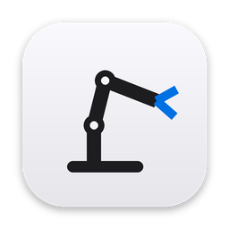
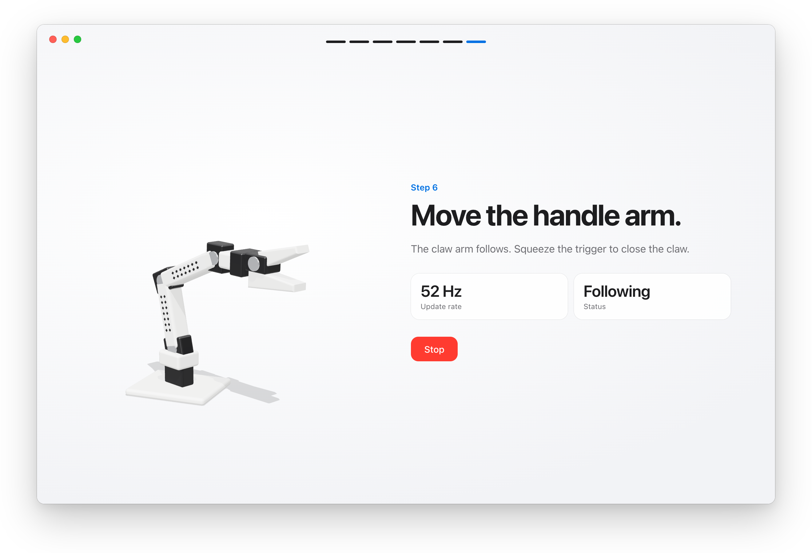
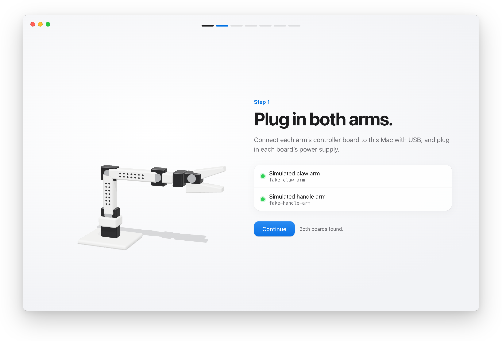
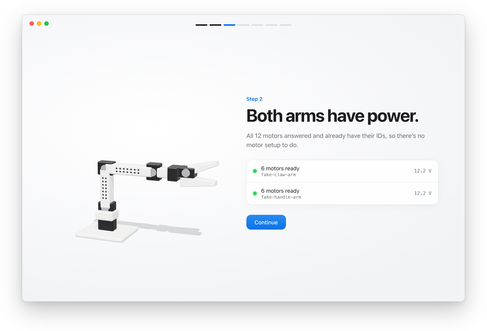
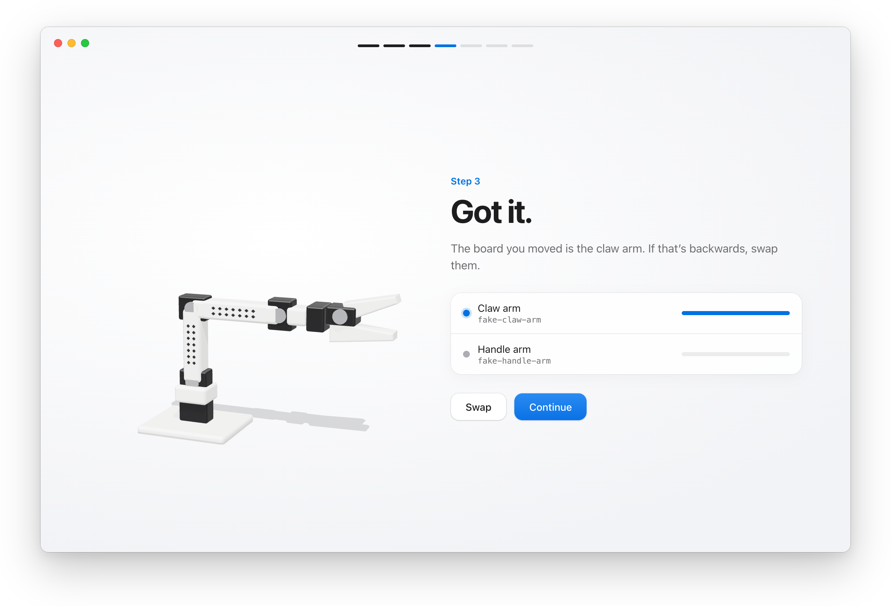
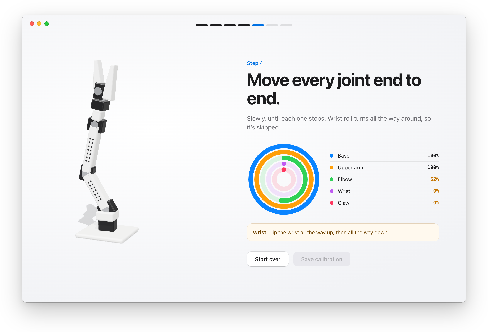

<div align="center">



# Pivot

**Set up SO-101 robot arms without a terminal.** From plugging in to teleoperation in about ten minutes, one step at a time.

<a href="https://github.com/cfahlgren1/pivot/releases/latest"></a>   <a href="https://github.com/huggingface/lerobot"></a>

<br>



</div>

## How it works

Pivot drives the arms through [LeRobot](https://github.com/huggingface/lerobot) and saves calibration where
LeRobot expects it, so `lerobot-record`, `lerobot-teleoperate` and training pick it up unchanged.

<table>
  <tr>
    <td width="50%"><br><b>1. Plug in.</b> Pivot finds both boards on its own. No port names to copy.</td>
    <td width="50%"><br><b>2. Power check.</b> Pings all 12 motors and reads their voltage, so a loose barrel plug shows up here, not halfway through calibration.</td>
  </tr>
  <tr>
    <td><br><b>3. Which arm is which.</b> Wiggle the claw arm and Pivot watches which board moves. No unplug test to get backwards.</td>
    <td><br><b>4–5. Calibrate.</b> Rings fill as you sweep each joint. Saving waits until every joint has covered its range.</td>
  </tr>
</table>

## Install

1. Download the `.dmg` from [Releases](https://github.com/cfahlgren1/pivot/releases/latest) and drag Pivot to Applications.
2. Pivot isn't notarized yet, so open it the first time with right-click → **Open** → **Open**.
   If macOS says it's damaged, run `xattr -dr com.apple.quarantine /Applications/Pivot.app`.
3. Plug in both arms (USB and power) and follow the screens.

Python and LeRobot are bundled. Nothing else to install.

## Why

Setup with the LeRobot command line works, but a real first setup hits these:

| On a real setup | Command line | Pivot |
| --- | --- | --- |
| Which USB port is which arm? | Unplug test, easy to get backwards | Move the claw arm; Pivot watches which board responds |
| A board with USB but no motor power (red PW light, no barrel plug) | Fails later with a vague error | Says to push the barrel plug in |
| A broadcast ping reports "no motors" on a healthy arm | Looks broken | Pings motor IDs one at a time |
| Pre-assembled kits already have motor IDs | You run motor setup anyway | Skipped when all six answer |
| A garbage reading right after homing | Saved as a joint limit | Ignored: a settle window, and impossible jumps are rejected |
| A joint swept only partway | Saved anyway | Saving waits until every joint reaches 80% of its range |
| Teleoperation starts | The claw arm snaps to the handle's pose | Eases into the pose over a second |
| One missed read | Ends teleoperation | Retries, then reconnects |

**Not yet:** setting IDs on brand-new motors (use `lerobot-setup-motors`), cameras and recording,
notarized builds, Windows and Linux.

## Develop

Requirements: [uv](https://docs.astral.sh/uv/), Node 20+ with pnpm, and Rust (the repo pins 1.96).

```sh
# Sidecar: logic and protocol tests against simulated arms
cd sidecar && uv sync && uv run pytest

# App
cd app && pnpm install
PIVOT_SIDECAR_ARGS="--fake" pnpm tauri dev   # simulated arms, no hardware needed
pnpm tauri dev                               # real arms
pnpm screenshots                             # regenerate the README screenshots

# Release: Pivot.app and a .dmg in dist/
./scripts/build-mac.sh
```

Other simulated scenarios: `--fake --scenario leader_unpowered` and `--fake --scenario glitch`.

```
app/       Tauri shell (src-tauri/) and the web UI (src/)
sidecar/   Python hardware sidecar: JSON lines over stdin/stdout, tests, simulated arms
scripts/   Build scripts
docs/      Screenshots and design mockups
```

The sidecar can be driven by hand: `echo '{"id":1,"method":"list_boards"}' | uv run pivot-sidecar --fake`.

The release app bundles a frozen sidecar without PyTorch: LeRobot's motor code imports it only for type
hints, so a small stand-in replaces it (`sidecar/packaging/torch_stub.py`), and the build checks every
LeRobot path Pivot uses still loads.

**Status:** prototype. Works end to end against simulated arms; real-hardware testing is in progress.
